# Estoque

Sistema de controle de estoque em monorepo: API REST em **Spring Boot** e front-end em **Angular**, empacotados com Docker.

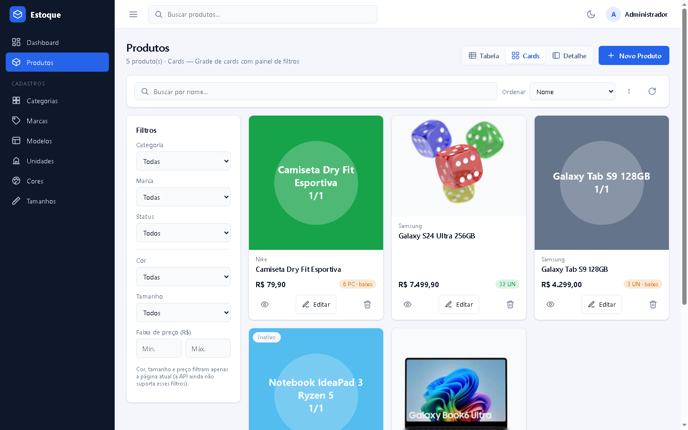

## Funcionalidades

- **Login com JWT** (HS512), tema claro/escuro e opção de acesso demo configurável.
- **Produtos** com 3 modos de visualização: **Tabela**, **Cards** e **Detalhe** (lista + painel com indicadores).
- Busca por nome, filtros (categoria, marca, status, cor, tamanho, faixa de preço), ordenação e paginação no servidor.
- **Cadastro de produto em abas**: dados gerais, **imagens** (até 10, com imagem principal, validação de tipo/tamanho) e **especificações** (chave/valor).
- Cadastros auxiliares: categorias, marcas, modelos (vinculados à marca), unidades, cores e tamanhos.
- Exclusões protegidas: itens em uso retornam 409 com a contagem de vínculos; confirmações em **modal próprio** (sem `confirm()` do navegador).
- Layout responsivo com menu lateral recolhível no celular.
- Migrations Flyway com dados de exemplo coerentes (eletrônicos e vestuário).

## Screenshots

| Login | Tabela |
|---|---|
| 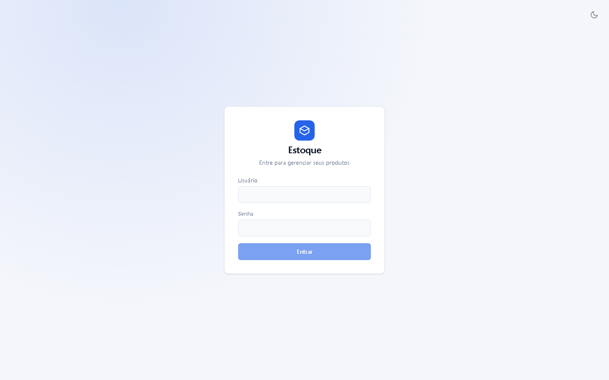 | 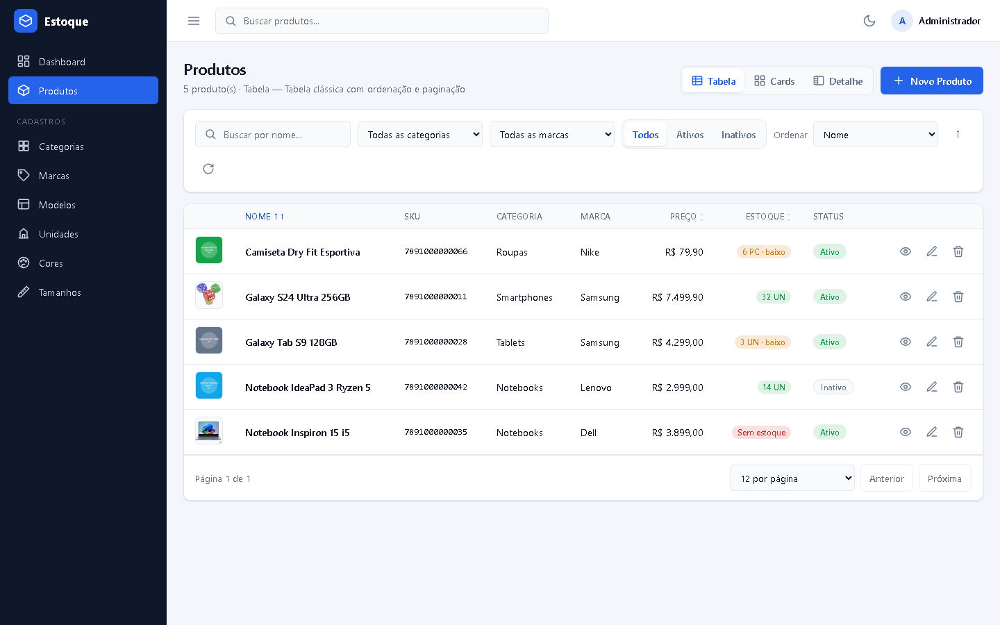 |
| **Cards** | **Detalhe** |
|  | 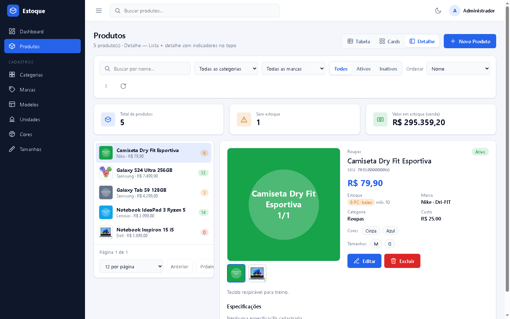 |
| **Cadastro** | **Imagens** |
| 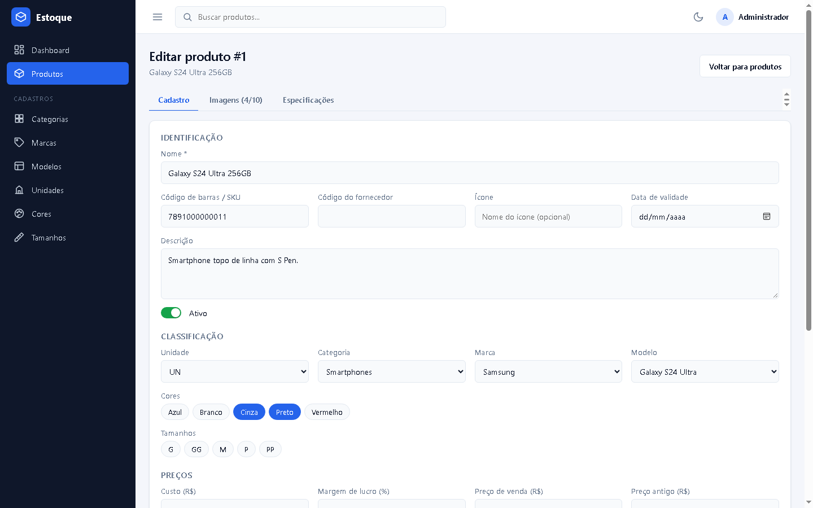 | 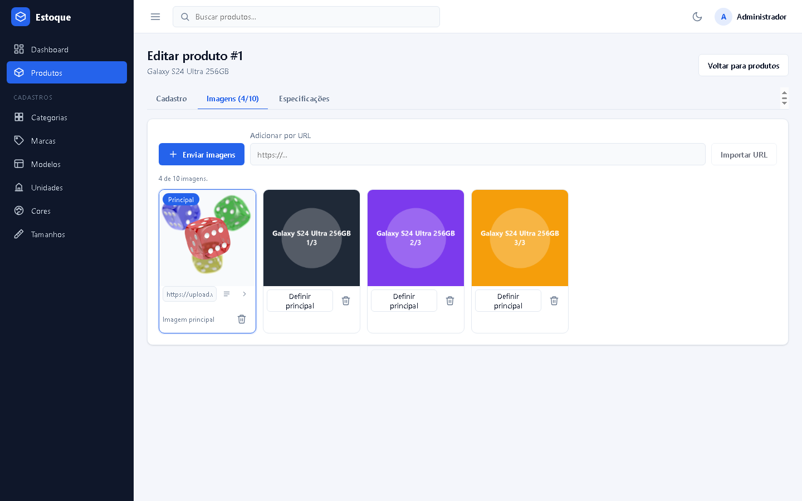 |
| **Especificações** | **Modal de confirmação** |
| 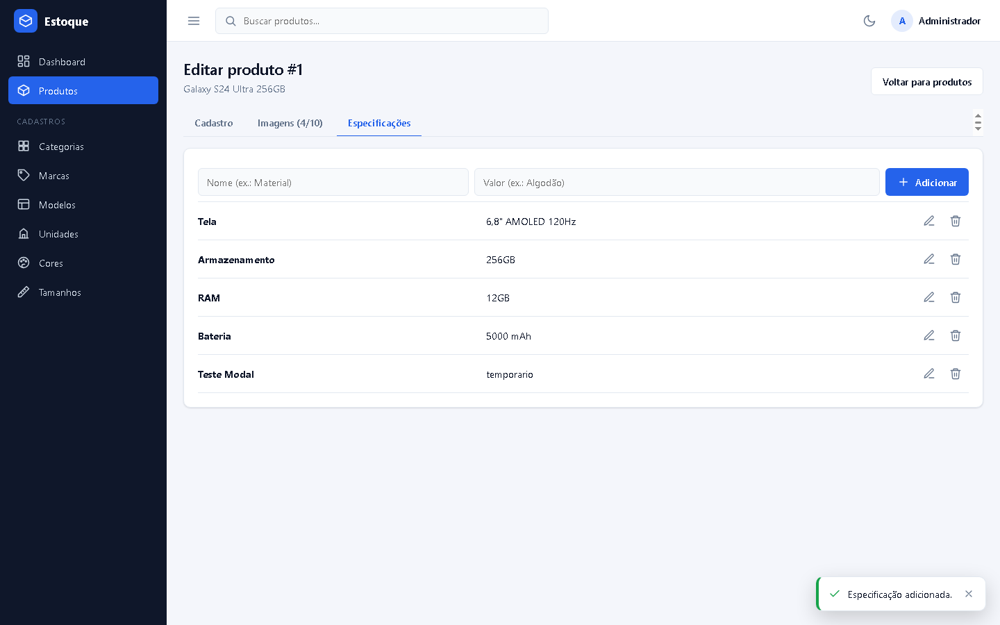 | 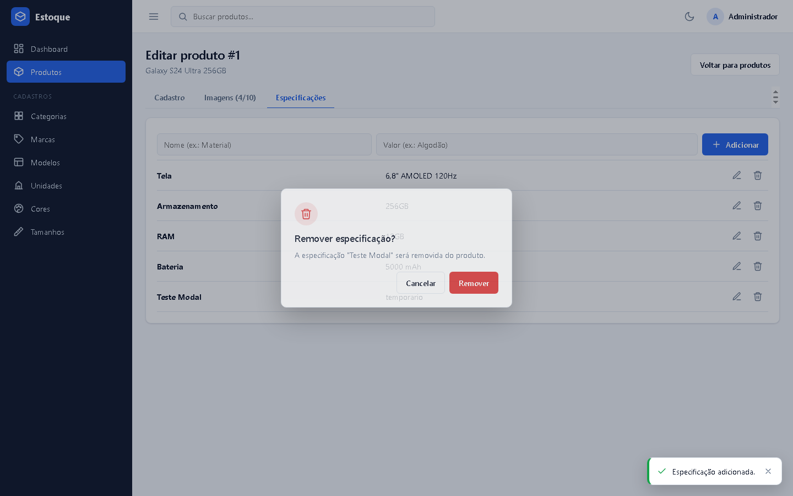 |
| **Tema escuro** | **Tema escuro (cadastro)** |
| 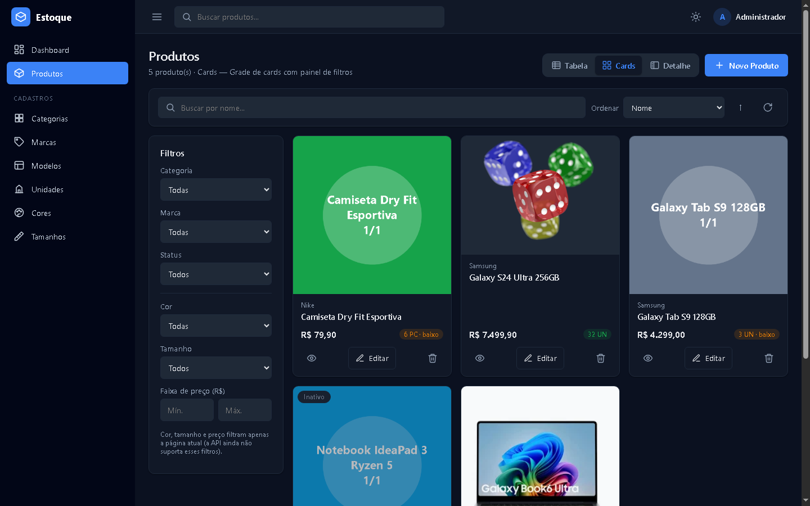 | 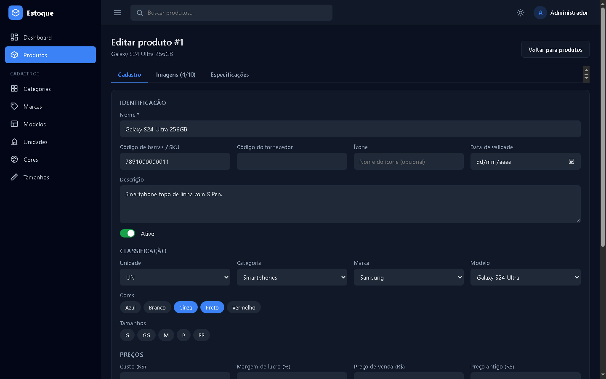 |

<p>
  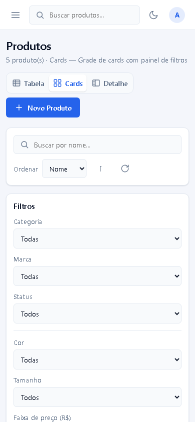
  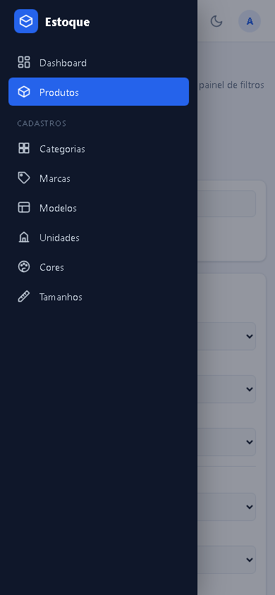
  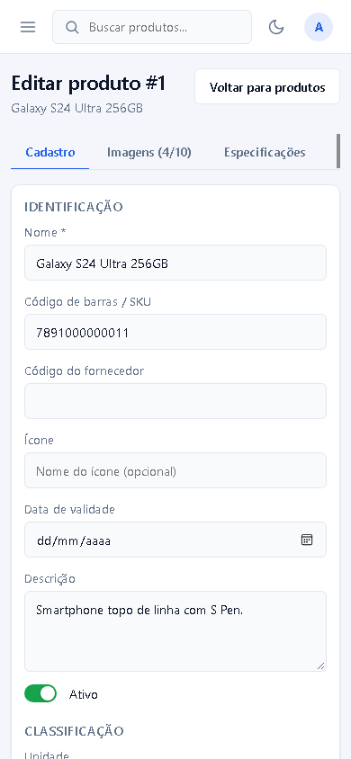
</p>

## Estrutura

```
estoque/
├── estoque-api/            # Spring Boot 2.5 (Java 8, PostgreSQL, Flyway, JWT)
├── estoque-web/            # Angular (servido por Nginx no Docker)
├── docs/screenshots/       # Imagens deste README
├── .github/workflows/ci.yml
├── docker-compose.yml      # Sobe banco, API e front
├── render.yaml             # Blueprint de deploy no Render
├── .env.example            # Modelo de variáveis de ambiente
└── LICENSE
```

## Início rápido (Docker Compose)

Requer Docker com Docker Compose.

```bash
cp .env.example .env
# edite o .env: DB_PASSWORD, JWT_SECRET (>= 64 bytes) e APP_ADMIN_SENHA
docker compose up -d --build
```

Serviços:

| Serviço | Descrição | Endereço |
|---|---|---|
| `db` | PostgreSQL 16 (volume `estoque-pgdata`) | interno (`db:5432`) |
| `api` | estoque-api | `http://localhost:7009/api/estoque` |
| `web` | estoque-web (Angular + Nginx) | `http://localhost:4300` |

Teste rápido:

```bash
curl -s -X POST http://localhost:7009/api/estoque/auth/login \
  -H 'Content-Type: application/json' \
  -d '{"login":"admin","senha":"<APP_ADMIN_SENHA>"}'
```

Para parar: `docker compose down` (adicione `-v` para apagar também os dados).

> Variáveis definidas no terminal têm prioridade sobre o `.env` na interpolação do Compose.

## Testes e CI

A API tem testes de integração com **JUnit 5 + MockMvc + Testcontainers** (PostgreSQL 16 real em container): autenticação, CRUD completo com exclusão em cascata, validação de imagens, regras de exclusão de cadastros auxiliares e consulta com filtros/ordenação/paginação.

```bash
cd estoque-api
./mvnw test        # requer Docker em execução (Windows: mvnw.cmd test)
```

O workflow [`.github/workflows/ci.yml`](.github/workflows/ci.yml) roda a cada push/PR: testes da API, build do front e build das duas imagens Docker.

## Configuração do front em runtime

O container `web` gera `config.js` na inicialização a partir de variáveis de ambiente, sem rebuild:

| Variável | Uso | Padrão |
|---|---|---|
| `API_URL` | URL base da API | `http://localhost:7009/api/estoque` |
| `DEMO_LOGIN` / `DEMO_SENHA` | Se preenchidas, a tela de login mostra o acesso demo e o botão "Entrar como demo" | vazias |
| `PORT` | Porta do Nginx | `80` |

## Deploy (Render, plano gratuito)

O arquivo [`render.yaml`](render.yaml) cria Postgres + API + front (ambos via Docker).

1. Crie o repositório no GitHub e faça o push deste projeto.
2. Crie uma conta em <https://render.com> e conecte o GitHub.
3. **New > Blueprint**, selecione o repositório e confirme o `render.yaml`.
4. Preencha as variáveis pedidas:
   - `APP_ADMIN_SENHA` (API) e `DEMO_SENHA` (web): a **mesma** senha do usuário demo (ela fica visível na tela de login; use uma senha exclusiva para a demo).
   - `APP_CORS_ALLOWED_ORIGINS` (API): `https://estoque-web.onrender.com` (URL do serviço web).
   - `API_URL` (web): `https://estoque-api.onrender.com/api/estoque`.
   - Se o Render atribuir nomes diferentes aos serviços, ajuste as duas URLs acima em **Environment** e faça **Manual Deploy**.
5. Aguarde o build. A API fica pronta quando `/api/estoque/actuator/health` responde `UP` (o Flyway cria o schema e os dados de exemplo).
6. Acesse a URL do serviço web e clique em **Entrar como demo**.

Observações do plano gratuito:
- Os serviços "dormem" após ~15 min sem acesso; o primeiro acesso pode levar ~1 min.
- O Postgres gratuito expira após cerca de 30 dias (recrie-o ou migre para um plano pago).
- O `JWT_SECRET` é gerado automaticamente pelo Render. O admin só é criado quando a tabela de usuários está vazia.

## Projetos

- [estoque-api](estoque-api/README.md): endpoints, variáveis de ambiente, migrations e execução local.
- [estoque-web](estoque-web/README.md): front-end, temas, modos de visualização e execução em dev.

## Licença

Distribuído sob a licença [MIT](LICENSE).

## Autor

Davy Lucas
